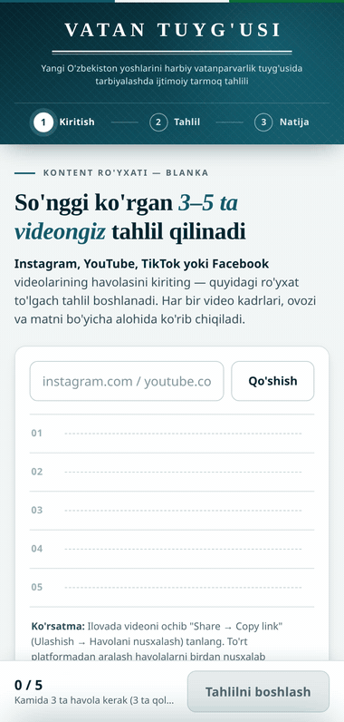
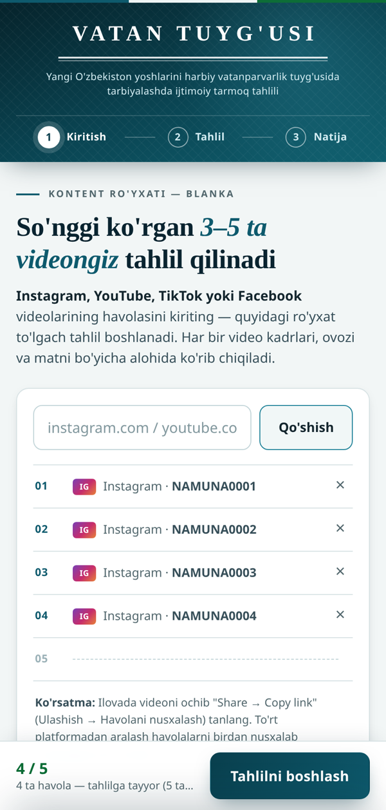
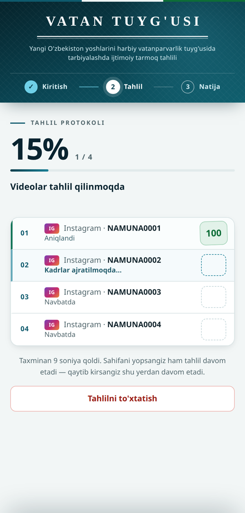
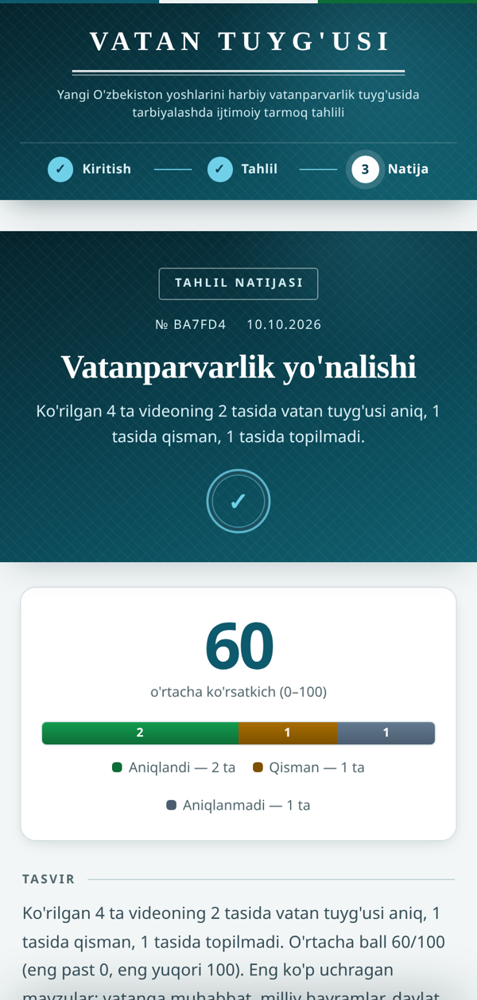
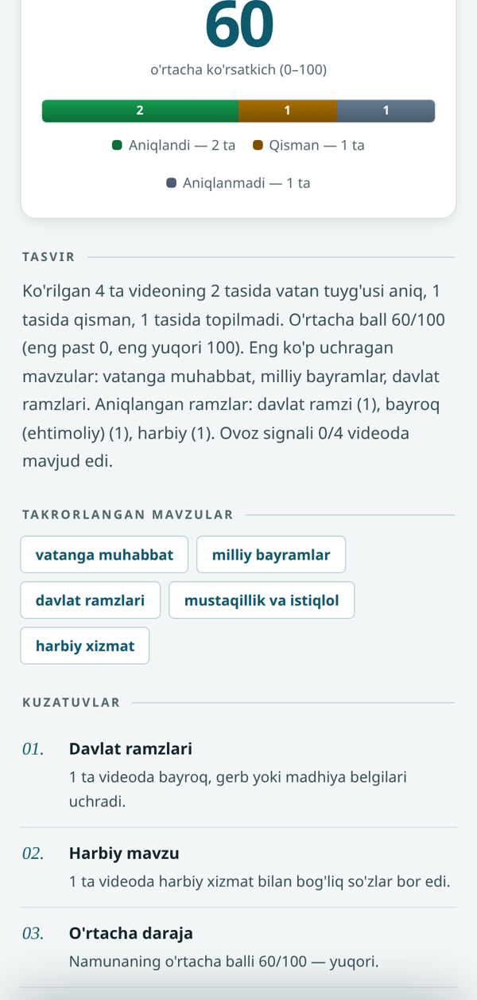
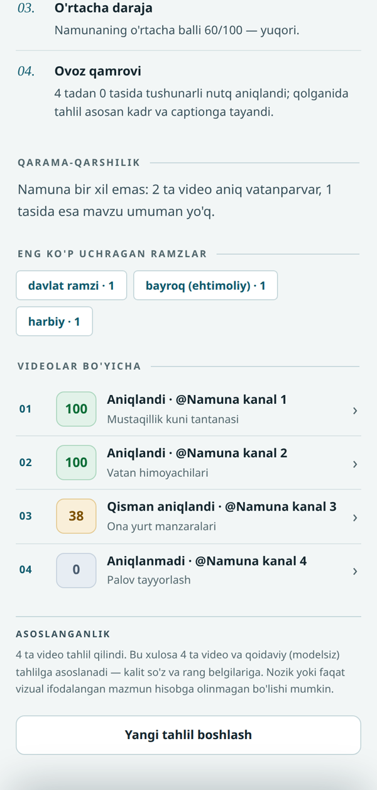
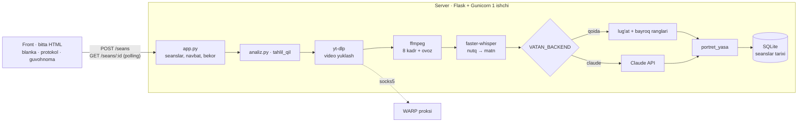

<div align="center">



**Foydalanuvchi ko'rgan 3–5 ta ijtimoiy tarmoq videosini (Instagram, YouTube, TikTok, Facebook) tahlil qilib, ularda vatanparvarlik mazmuni bor-yo'qligini baholaydigan va natijani bitta «guvohnoma»-portretga jamlaydigan web ilova.**


-0e5a6d)

</div>

---

## Uch ekran: blanka → protokol → guvohnoma

<div align="center">

</div>

Foydalanuvchi havolalarni «blanka»ga kiritadi (3 tasidan keyin tugma yonadi, 5 tada to'xtaydi). Har video o'z qatorida jonli qadam matni bilan tahlil qilinadi va ball **muhr** bo'lib bosiladi. Oxirida barcha natija bitta rasmiy hujjat ko'rinishidagi portretga jamlanadi; sahifa yopilsa ham tahlil serverda davom etadi va qaytib kirganda tiklanadi.

## Asosiy imkoniyatlar

| | |
|---|---|
| 🎬 **4 platforma** | Instagram, YouTube, TikTok va Facebook havolalari tanib olinadi va kanonik ko'rinishga keltiriladi (takror havola rad etiladi) |
| 🖼️ **Kadr va ovoz** | yt-dlp videoni yuklaydi, ffmpeg 8 ta kadr (uzun tomoni 896 px) va 16 kHz ovoz ajratadi |
| 🗣️ **Nutq → matn** | faster-whisper (CPU, int8) o'zbekcha nutqni matnga o'giradi; kirill va lotin bir xil tushuniladi |
| 📏 **Qoidaviy baho (standart)** | Tashqi API'siz: 9 toifali vaznli lug'at (davlat ramzlari, mustaqillik, harbiy xizmat, xotira, vatanga muhabbat…) nutq va izoh matni ustida + kadrlarda bayroq ranglarini aniqlash (Pillow). Ball 0–100 → «Aniqlandi / Qisman / Aniqlanmadi» |
| 🛡️ **Halollik qoidalari** | Reklama so'zlari «aniq»ni «qisman»ga tushiradi, kinoya va boshqa davlat ramzlari qarshi dalil; bayroq «ehtimoliy» deb belgilanadi; har natijada «qoidaviy, ma'no anglanmaydi» ogohlantirishi |
| 📜 **Portret** | Sanoq, foiz, o'rtacha, takrorlangan mavzular va ramzlar **Python'da hisoblanadi** — o'ylab topilmaydi |
| 🤖 **Ixtiyoriy LLM rejimi** | `VATAN_BACKEND=claude` bilan baholash va portret tashqi Claude API orqali (kalit va kredit kerak); natija shakli bir xil, front o'zgarmaydi |
| ⏹️ **Haqiqiy bekor qilish** | «To'xtatish» bosilsa navbatdagi videolar boshlanmaydi |
| 🌐 **Data-markaz IP bloki** | Server IP'sini platformalar «bot» deb rad etgani uchun Cloudflare WARP proksi rejimi va docker interfeysidagi socat ko'prigi (`deploy/proksi-*.sh`) |

## Ekranlar

<table>
<tr>
<td width="33%"><br/><sub><b>Blanka</b> — havolalar ro'yxati va yopishqoq harakat paneli</sub></td>
<td width="33%"><br/><sub><b>Protokol</b> — har video jonli qadam bilan, ball muhr bo'lib bosiladi</sub></td>
<td width="33%"><br/><sub><b>Guvohnoma</b> — yo'nalish, o'rtacha ko'rsatkich, taqsimot</sub></td>
</tr>
<tr>
<td><br/><sub><b>Portret</b> — tavsif, takrorlangan mavzular, kuzatuvlar</sub></td>
<td><br/><sub><b>Videolar bo'yicha</b> — har biriga ball va asoslanganlik</sub></td>
<td></td>
</tr>
</table>

> Suratlar dasturning **haqiqiy ishlashidan** olingan, lekin kirish **sun'iy**: ffmpeg bilan chizilgan 4 ta namuna video (bayroq, manzara, harbiy saf, oshxona) va o'ylab topilgan izohlar; «Namuna kanal» nomlari soxta. Natija (100 / 100 / 38 / 0, o'rtacha 60) qoidaviy yadro hisoblagan.

## Arxitektura



- **Gunicorn 1 ishchi** — seanslar va fon oqimlari jarayon xotirasida; parallel videolar soni `VATAN_PARALLEL` bilan.
- **Joylash:** o'z Caddy'si yo'q, host porti band qilinmaydi — mavjud Caddy tarmog'iga qo'shiladi, Caddyfile'ga marker bilan blok yoziladi (zaxira → `caddy validate` → xato bo'lsa qaytarish → `reload`). `olib-tashla.sh` faqat o'z blokini o'chiradi.

## Sifat

- Avtomatik sinovlar to'plami **yo'q**.
- Tekshirilgani: to'liq zanjir (kadr → ovoz → qoidaviy baho → portret) yuqoridagi 4 ta sun'iy video bilan ishga tushirildi va natija ekranlarda ko'rinib turibdi; `python3 -m py_compile app.py analiz.py` xatosiz.

## Ishga tushirish

```bash
python3 -m venv .venv && . .venv/bin/activate
pip install -r requirements.txt            # ffmpeg tizimda bo'lmasa imageio-ffmpeg binari ishlatiladi
cp .env.example .env && set -a && . ./.env && set +a
python3 app.py                             # http://127.0.0.1:5057
curl -s http://127.0.0.1:5057/tekshiruv    # muhit holati: backend, ffmpeg, whisper, yt-dlp
```

Serverga (Docker + mavjud Caddy): `deploy/README.md`, `deploy/.env.example`, `sudo bash deploy/ornat.sh`.

## Texnologiyalar

Python · Flask · Gunicorn · yt-dlp · ffmpeg / imageio-ffmpeg · faster-whisper (CTranslate2) · Pillow · SQLite · kutubxonasiz JavaScript va CSS · Claude API (ixtiyoriy) · Docker · Caddy · Cloudflare WARP + socat

## Jonli

🌐 **https://vatan.unistart-hub.uz**

---

<div align="center">

**Manba kodi ochiq.** Savol va hamkorlik bo'yicha: Telegram [@Humoyun_Davronov](https://t.me/Humoyun_Davronov)

<sub>Muallif — Humoyun Davronov</sub>

</div>
